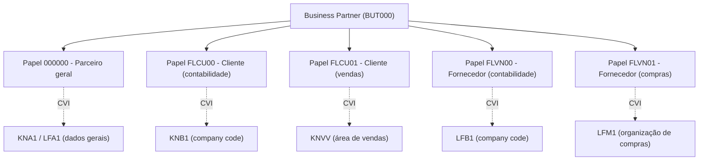
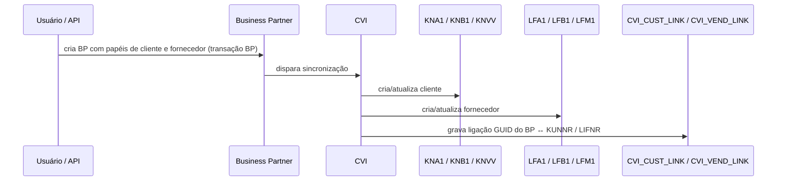
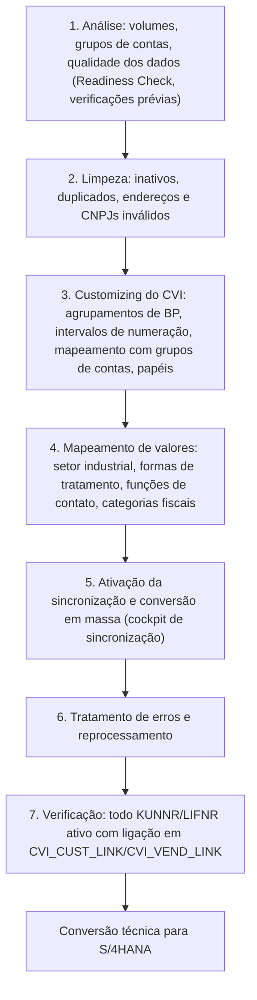

# SAP Business Partner - Study

> Nível: prática
> O Business Partner (BP) como dado mestre único de clientes, fornecedores e demais parceiros, obrigatório no S/4HANA, e a *Customer/Vendor Integration* (CVI) que o sincroniza com `KNA1`/`LFA1`. Relacionados: [SAP ECC](https://github.com/igor-barral/SAP-ECC-erp-study), [SAP S/4HANA (índice da fase 0)](https://github.com/igor-barral/SAP-S4HANA-erp-study), [Estrutura organizacional](https://github.com/igor-barral/SAP-Enterprise-Structure-erp-study), [Migração para S/4HANA](https://github.com/igor-barral/SAP-S4HANA-Migration-erp-study), [SD](https://github.com/igor-barral/SAP-SD-erp-study), [MM](https://github.com/igor-barral/SAP-MM-erp-study).

## Objetivo

Entender o que é o Business Partner, por que ele substituiu a manutenção separada de clientes e fornecedores e o que precisa estar pronto num ECC antes da conversão para S/4HANA. A conversão de clientes e fornecedores em BP (o chamado "CVI") é uma das atividades obrigatórias de todo projeto *brownfield* e aparece com frequência em vagas e entrevistas. Para o desenvolvedor, BP também muda as cargas de dados, as integrações e os programas que criavam cliente ou fornecedor.

Ao concluir este estudo você deverá ser capaz de responder perguntas como:

- O que é um Business Partner e quais são suas categorias?
- Por que o Business Partner substituiu cliente e fornecedor?
- O que são papéis de BP e como eles se relacionam com `KNA1`, `KNB1`, `LFA1`...?
- O que é CVI e como funciona a sincronização?
- O que acontece com XD01 e XK01 no S/4HANA?
- O que precisa estar pronto no ECC antes de migrar?
- Como criar ou ler um BP a partir de código?

---

## Ponte

| No que eu já conheço | No SAP |
|---|---|
| Tabelas `clientes` e `fornecedores` com CNPJ e endereço duplicados | ECC: `KNA1` e `LFA1` separados |
| Refatoração para `pessoas` + `pessoa_papeis` (cliente, fornecedor, transportadora) | Business Partner (`BUT000`) + papéis (`BUT100`) |
| Tabela de pessoa física e jurídica com um campo `tipo` | Categoria de BP: pessoa, organização, grupo |
| Manter as tabelas antigas atualizadas por *trigger* ou evento para não quebrar módulos legados | CVI: grava o BP e sincroniza `KNA1`/`LFA1` para os módulos que ainda leem essas tabelas |
| Tabela de ligação `pessoa_id` ↔ `cliente_id_legado` durante a migração | `CVI_CUST_LINK` e `CVI_VEND_LINK` |
| Script de migração que precisa de dados limpos e numeração alinhada antes de rodar | Preparação do CVI no ECC: limpeza, numeração, mapeamentos, sincronização em massa |
| Endpoint REST de cadastro de pessoas | API OData de Business Partner no SAP Business Accelerator Hub |

---

## Conteúdo

### 1. O que é o Business Partner

O Business Partner é o objeto de dado mestre central para **qualquer pessoa ou organização com quem a empresa se relaciona**: cliente, fornecedor, contato, funcionário em alguns cenários, banco, transportadora. Ele já existia antes do S/4HANA em produtos como SAP CRM, SRM e em partes do FI (FSCM, gestão de crédito); no S/4HANA, passou a ser o **único ponto de manutenção** de clientes e fornecedores.

| Categoria | Uso |
|---|---|
| Pessoa (1) | Pessoa física: nome, sobrenome, data de nascimento |
| Organização (2) | Pessoa jurídica: razão social, forma jurídica |
| Grupo (3) | Grupo de pessoas ou organizações (casal, consórcio) |

A categoria define quais campos gerais o BP tem e não pode ser trocada depois da criação.

### 2. Por que substituiu cliente e fornecedor

| Problema no modelo ECC | Solução com BP |
|---|---|
| Uma empresa que é cliente e fornecedora tem dois cadastros, com endereço e CNPJ duplicados | Um único BP com dois papéis |
| Dados gerais divergentes entre `KNA1` e `LFA1` ao longo do tempo | Dados gerais mantidos uma vez |
| Endereços sem versionamento, um endereço principal | Vários endereços com usos e validade no tempo |
| Relacionamentos (contato, matriz/filial) modelados de forma diferente em cada lado | Relacionamentos de BP genéricos |
| Transações diferentes para cada área (XD01, VD01, FD01, XK01, MK01, FK01) | Uma transação, `BP`, com visões por papel |
| Modelo diferente entre ERP e CRM/SRM | Mesmo objeto de parceiro em toda a suíte |

### 3. Papéis e a relação com as tabelas antigas

Cada **papel** (*BP role*) ativa um conjunto de visões e, no caso de cliente e fornecedor, corresponde a um nível das tabelas antigas.



| Papel | Descrição | Tabelas do BP | Tabelas sincronizadas via CVI |
|---|---|---|---|
| `000000` | Parceiro de negócios (geral) | `BUT000`, `BUT020` (endereços), `ADRC` | - |
| `FLCU00` | Cliente, dados de contabilidade | - | `KNA1`, `KNB1` |
| `FLCU01` | Cliente, dados de vendas | - | `KNA1`, `KNVV` |
| `FLVN00` | Fornecedor, dados de contabilidade | - | `LFA1`, `LFB1` |
| `FLVN01` | Fornecedor, dados de compras | - | `LFA1`, `LFM1` |

Outras tabelas do BP que aparecem com frequência:

| Tabela | Conteúdo |
|---|---|
| `BUT000` | Dados gerais do BP (número `PARTNER`, categoria, nome, GUID) |
| `BUT020` | Endereços do BP (ligação com `ADRC`) |
| `BUT100` | Papéis atribuídos ao BP |
| `BUT0BK` | Dados bancários |
| `BUT050` | Relacionamentos entre BPs |
| `DFKKBPTAXNUM` | Números de identificação fiscal (CNPJ, CPF, inscrições) por categoria |

Os nomes de papéis e tabelas acima são os do padrão; projetos podem ter papéis adicionais. Confirme com a SE11 e a transação `BP` no sistema.

### 4. CVI: Customer/Vendor Integration

O CVI é o mecanismo que mantém BP e cliente/fornecedor sincronizados. No S/4HANA, **o BP é o objeto líder**: a manutenção acontece no BP, e o CVI grava as tabelas de cliente e fornecedor para que SD, MM, FI e todo o código existente continuem lendo `KNA1`, `LFA1`, `KNB1` etc.



Pontos centrais:

- **Tabelas de ligação**: `CVI_CUST_LINK` liga o GUID do BP ao número de cliente (`KUNNR`); `CVI_VEND_LINK` liga ao número de fornecedor (`LIFNR`). Pessoas de contato têm ligação própria (confirme as tabelas `CVI_*_CT_LINK` no sistema).
- **Numeração**: o projeto decide se o número do BP é igual ao do cliente/fornecedor (recomendado quando possível, facilita suporte e integração) ou diferente. Isso é configurado por agrupamento de BP e intervalos de numeração, mapeados para os grupos de contas de cliente e fornecedor.
- **Direção**: no ECC o CVI pode ser configurado nos dois sentidos (cliente → BP e BP → cliente); no S/4HANA a direção de manutenção é sempre a partir do BP.

### 5. O que acontece com XD01, XK01 e afins

No S/4HANA, as transações antigas de manutenção de cliente e fornecedor (XD01/XD02/XD03, VD01..., FD01..., XK01/XK02/XK03, MK01..., FK01...) **redirecionam para a transação `BP`** ou deixam de ser a forma suportada de manutenção. Programas custom que chamavam essas transações por *batch input* (BDC) ou gravavam `KNA1`/`LFA1` diretamente precisam ser reescritos para usar as APIs de BP.

### 6. O que precisa estar pronto no ECC antes de migrar

A conversão para S/4HANA exige que **todo cliente e todo fornecedor ativo já tenha um BP** antes da conversão técnica. Essa é a preparação do CVI, feita no ECC, normalmente semanas ou meses antes.



| Etapa | Ponto de atenção |
|---|---|
| Limpeza | Cadastros duplicados viram BPs duplicados; o momento de unificar é antes |
| Numeração | Se BP e cliente devem ter o mesmo número, os intervalos precisam ser compatíveis e sem sobreposição entre clientes e fornecedores |
| Mapeamentos | Campos com valores próprios no cliente e no BP (ex.: setor, forma de tratamento) precisam de tabela de correspondência, senão a sincronização falha |
| Fiscal Brasil | CNPJ, CPF e inscrições devem ser migrados para as categorias fiscais de BP (tabela `DFKKBPTAXNUM`); confirme as categorias `BR*` configuradas no sistema |
| Contatos | Pessoas de contato do cliente/fornecedor viram BPs pessoa com relacionamento |
| Cockpit | A sincronização em massa usa o cockpit de sincronização de dados mestres (transação `MDS_LOAD_COCKPIT` no ECC; há também um cockpit específico para preparação de conversão, confirme a disponibilidade via notas SAP) |
| Erros | Monitor de pós-processamento (transação `MDS_PPO2`) para corrigir e reprocessar |
| Código custom | Programas que criavam cliente/fornecedor por BDC ou `INSERT` precisam ser adaptados |

A preparação do CVI é o assunto de muitos guias e notas SAP; siga o guia de conversão da release de destino. Ligação com [SAP-S4HANA-Migration-erp-study](https://github.com/igor-barral/SAP-S4HANA-Migration-erp-study).

### 7. BP no código

A forma de acessar o BP depende de onde o código roda:

| Cenário | Leitura | Criação / alteração |
|---|---|---|
| ABAP clássico (ECC ou S/4HANA on-premise) | `SELECT` em `BUT000`, `BUT020`, e `KNA1`/`LFA1` para dados de cliente/fornecedor | BAPIs `BAPI_BUPA_*` (BP geral) ou a classe `CL_MD_BP_MAINTAIN`, que mantém BP, cliente e fornecedor numa chamada |
| ABAP Cloud (S/4HANA Cloud, código novo) | CDS Views liberadas do VDM (ex.: `I_BusinessPartner`, `I_Customer`, `I_Supplier`; confirme o status de liberação no ADT) | APIs liberadas (RAP/EML) para Business Partner, conforme documentação da release |
| Integração externa | API OData de Business Partner publicada no SAP Business Accelerator Hub | Mesma API (POST/PATCH) |

Exemplo de leitura em ABAP Cloud, usando views do VDM em vez de tabelas:

```abap
" Lê BPs do tipo organização com o papel de cliente.
" Confirme no ADT os nomes dos campos e o status de liberação das views.
SELECT FROM i_businesspartner AS bp
  INNER JOIN i_customer AS cust
    ON cust~customer = bp~businesspartner
  FIELDS bp~businesspartner,
         bp~organizationbpname1,
         cust~customer
  WHERE bp~businesspartnercategory = '2'
  INTO TABLE @DATA(lt_customers)
  UP TO 50 ROWS.
```

O `JOIN` pela igualdade entre número de BP e número de cliente só funciona quando a numeração foi alinhada; no caso geral, a ligação passa pelas tabelas ou views do CVI. É exatamente o tipo de detalhe que muda de projeto para projeto e que vale perguntar logo no início.

---

## Respostas

**O que é um Business Partner e quais são suas categorias?**
É o dado mestre único para pessoas e organizações com quem a empresa se relaciona. As categorias são pessoa, organização e grupo; a categoria define os campos gerais e não muda após a criação.

**Por que o Business Partner substituiu cliente e fornecedor?**
Para eliminar a duplicação de dados gerais quando o mesmo parceiro é cliente e fornecedor, permitir vários endereços com validade, relacionamentos genéricos, uma única transação de manutenção e o mesmo modelo de parceiro em toda a suíte.

**O que são papéis de BP?**
Papéis ativam visões do BP. `FLCU00` e `FLCU01` correspondem a cliente em contabilidade (`KNB1`) e vendas (`KNVV`); `FLVN00` e `FLVN01`, a fornecedor em contabilidade (`LFB1`) e compras (`LFM1`). Os dados gerais vão para `KNA1`/`LFA1`.

**O que é CVI e como funciona a sincronização?**
É o mecanismo que grava cliente e fornecedor a partir do BP e registra a ligação em `CVI_CUST_LINK` e `CVI_VEND_LINK`. No S/4HANA o BP é o objeto líder, e as tabelas antigas continuam existindo para os módulos e o código que as leem.

**O que acontece com XD01 e XK01 no S/4HANA?**
Redirecionam para a transação `BP` ou deixam de ser a forma suportada de manutenção. Código custom que usava essas transações por BDC ou gravava as tabelas diretamente precisa passar a usar as APIs de BP.

**O que precisa estar pronto no ECC antes de migrar?**
Todo cliente e fornecedor ativo precisa ter BP e ligação CVI. Isso exige limpeza de dados, customizing de agrupamentos e numeração, mapeamento de valores (inclusive categorias fiscais brasileiras), sincronização em massa pelo cockpit, tratamento de erros e verificação final das ligações.

**Como criar ou ler um BP a partir de código?**
No ABAP clássico, leitura em `BUT000`/`KNA1`/`LFA1` e gravação por BAPIs de BP ou `CL_MD_BP_MAINTAIN`. Em ABAP Cloud, CDS Views liberadas do VDM e APIs RAP liberadas. De fora do sistema, a API OData de Business Partner do SAP Business Accelerator Hub.

---

## Referências

- SAP Help Portal: https://help.sap.com (buscar "Business Partner", "Customer Vendor Integration", "conversion guide SAP S/4HANA")
- SAP Business Accelerator Hub: https://api.sap.com (buscar "Business Partner")
- SAP Learning: https://learning.sap.com (buscar "Business Partner SAP S/4HANA")
- SAP Community: https://community.sap.com (buscar "CVI conversion", "MDS_LOAD_COCKPIT", "BP number range alignment")
